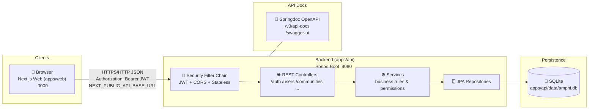
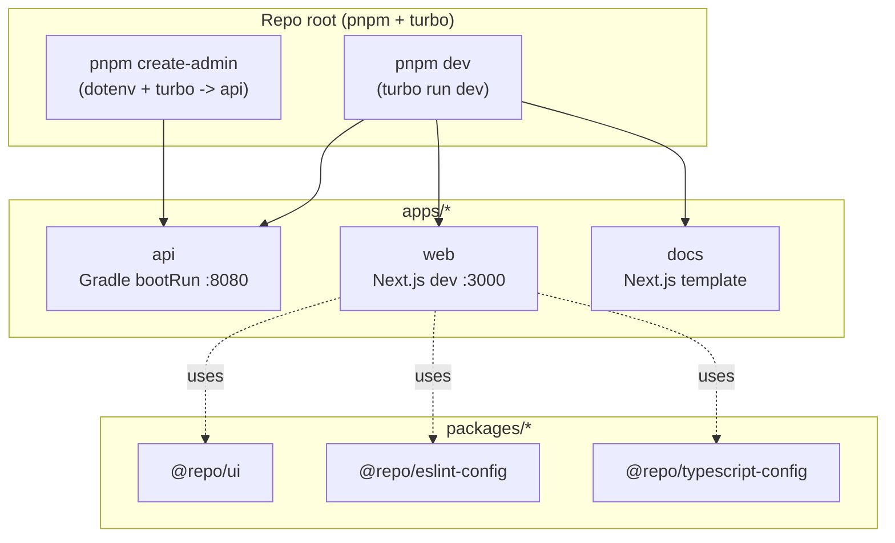
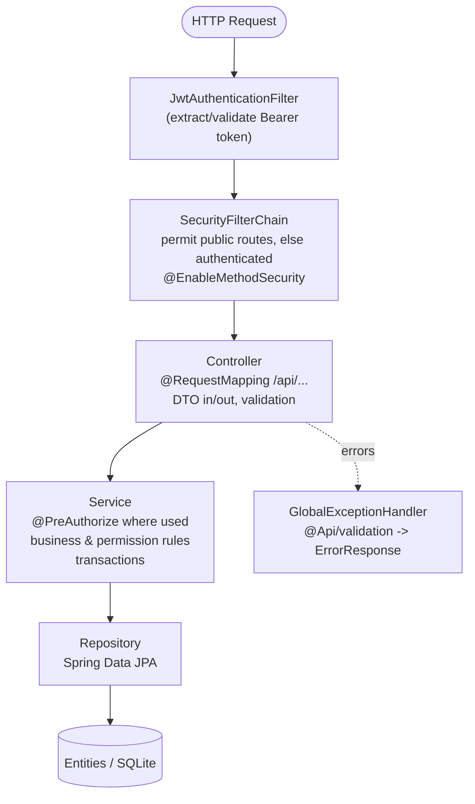
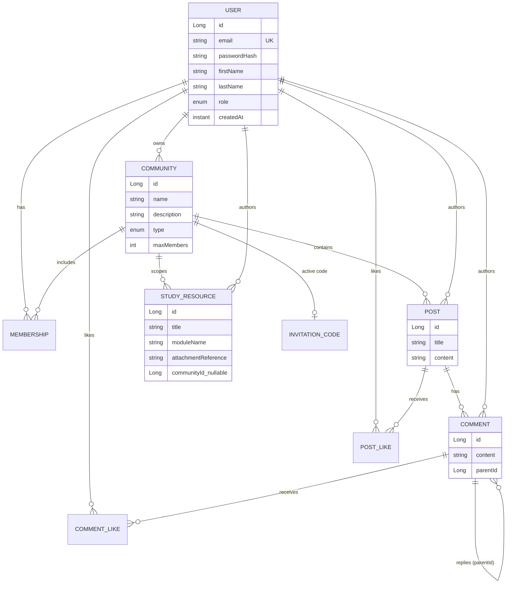
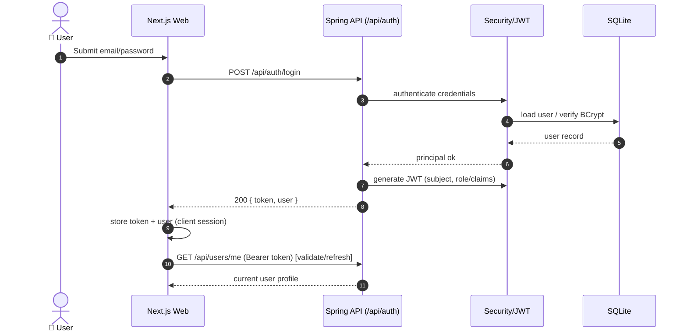
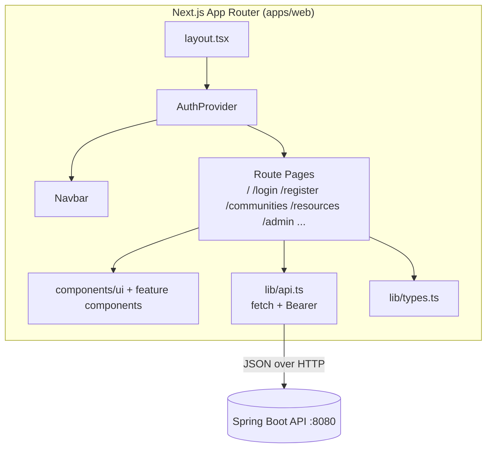

# Amphi — Architecture & Components

This document describes how Amphi is structured and how its parts work together: monorepo layout, backend (Spring Boot) modules, frontend (Next.js) composition, data model, and key runtime flows.

> Snapshot based on the current repository state (Spring Boot 4.1.2 / Gradle, Next.js 16 / React 19, SQLite, JWT auth, Turborepo + pnpm).

## 1. System overview

Amphi is a university social platform providing **communities**, **posts/comments/reactions**, and **study resources**, with **role-based access** (`STUDENT`, `PROFESSOR`, `ADMIN`). It is delivered as a monorepo:

- **`apps/api`**: stateless REST/JSON backend (source of truth, authz/authn, persistence)
- **`apps/web`**: browser client (App Router) consuming the API via `fetch` with JWT bearer tokens
- **`apps/docs`**: Next.js workspace app (template)
- **`packages/*`**: shared TS/ESLint/UI building blocks



## 2. Monorepo & build/run architecture

- **Workspace:** `pnpm-workspace.yaml` (`apps/*`, `packages/*`), root scripts delegate to **Turborepo** (`turbo.json`).
- **Key tasks:** `dev` (persistent, no cache), `build` (depends on `^build`), `lint`, `check-types`, `create-admin` (cache off, passes through `APP_ADMIN_*`/`ADMIN_*` env vars).
- **Root `pnpm dev`:** runs all packages exposing `dev` (notably `api` → `./gradlew bootRun`, `web` → `next dev --port 3000`, and `docs`).
- **Root `pnpm create-admin`:** loads root `.env` (`dotenv-cli`) then `turbo run create-admin --filter=api` to bootstrap/update an admin without starting the web server.



## 3. Backend architecture (`apps/api`)

**Stack:** Spring Boot 4.1.2, Spring Web/Data JPA/Security/Validation, SQLite (Hibernate community dialect, `ddl-auto=update`, FK pragma), JJWT, Springdoc OpenAPI. Base package: `me.matta.amphi`.

### 3.1 Package-by-feature organization

Each domain/feature is organized with clear layers (where applicable): `entity`, `repository`, `service`, `controller`, `dto`. Shared concerns live in `common`.

| Package | Responsibility (high level) |
| --- | --- |
| `auth` | Registration & login endpoints/DTOs; issues JWT (`AuthService`) |
| `user` | `User`/`Role` model, profile lookup, **admin** list/update-role endpoints |
| `community` | Community CRUD, visibility/type rules (public/private), owner/admin-aware operations |
| `membership` | Join/leave, member listing/removal, membership constraints |
| `invitation` | Active invitation code per private community, validation for joins |
| `post` | Community posts CRUD and access checks |
| `comment` | Comments & replies (self-referencing via `parentId`, flat responses), edit/delete rules |
| `reaction` | Like/unlike for posts and comments (uniqueness per user/target) |
| `studyresource` | Study materials, optional community scoping, attachment reference |
| `common.security` | `SecurityConfig`, JWT filter/service, CORS, stateless session, method security |
| `common.config` | OpenAPI bean (API info + bearer auth scheme) |
| `common.bootstrap` | `AdminBootstrapRunner` (conditional, used by `createAdmin`) |
| `common.exception` / `common.dto` | Typed exceptions, global handler, error/response shapes |



### 3.2 Security & API access (summary)

- **Stateless** JWT auth; public registration/login (`/api/auth/**`), public OpenAPI/Swagger, and selected **GET** endpoints for communities/posts/comments/study resources are permitted anonymously (as configured in `SecurityConfig`); other routes require authentication. **Admin** operations additionally require `ROLE_ADMIN` (e.g. user listing/role update).
- **CORS:** allows `http://localhost:3000`, `http://localhost:3001`.
- **Identity:** acting user resolved from `SecurityContext` (not trusted from client input).

### 3.3 REST API surface (controllers)

| Controller (base/path) | Endpoints (summary) |
| --- | --- |
| `AuthController` `/api/auth` | `POST /register`, `POST /login` |
| `UserController` `/api/users` | `GET /me`, `GET /` *(ADMIN)*, `GET /{id}`, `PATCH /{id}/role` *(ADMIN)* |
| `CommunityController` `/api/communities` | `GET /`, `POST /`, `GET /{id}`, `PATCH /{id}`, `DELETE /{id}`, `POST /{id}/members/join`, `DELETE /{id}/members/me`, `GET /{id}/members`, `DELETE /{id}/members/{userId}`, `POST /{id}/invitation`, `GET /{id}/invitation` |
| `PostController` | `GET/POST /api/communities/{communityId}/posts`, `GET/PATCH/DELETE /api/posts/{postId}` |
| `CommentController` | `GET/POST /api/posts/{postId}/comments`, `POST /api/comments/{commentId}/replies`, `PATCH/DELETE /api/comments/{commentId}` |
| `ReactionController` `/api` | `POST/DELETE /posts/{postId}/likes`, `POST/DELETE /comments/{commentId}/likes` |
| `StudyResourceController` `/api/study-resources` | `GET /`, `POST /`, `GET /{id}`, `PATCH /{id}`, `DELETE /{id}` |

> Exact request/response schemas, validation, and auth requirements: see Swagger/OpenAPI when the API is running.

## 4. Domain & data model

Core entities (JPA): `User`, `Community`, `Membership`, `InvitationCode`, `Post`, `Comment`, `PostLike`, `CommentLike`, `StudyResource`, with enums like `Role` and `CommunityType`.



**Notes:** comments are stored with optional self-reference and exposed as a flat list with `parentId` (client builds trees); likes are separate per-target entities with uniqueness constraints; invitation codes are managed per private community (active/regeneratable).

## 5. Key runtime flows

### 5.1 Authentication (login)



### 5.2 Private community join (invitation)

```mermaid
flowchart TD
    U[👤 Authenticated user] --> J[POST /api/communities/{id}/members/join]
    J --> T{Community type?}
    T -->|PUBLIC| M[MembershipService: validate capacity/duplicates]
    T -->|PRIVATE| I[Validate invitation code]
    I --> M
    M --> OK[(Persist Membership)]
    OK --> R[200/201 response]
```

## 6. Frontend architecture (`apps/web`)

**Stack:** Next.js 16 (App Router), React 19, TypeScript, Tailwind CSS v4, shadcn/ui + Radix primitives, `lucide-react`. API base URL from `NEXT_PUBLIC_API_BASE_URL` (default `http://localhost:8080`).

### 6.1 Composition

- **`app/layout.tsx`**: root layout, font, `AuthProvider`, global `Navbar`, main container/footer.
- **`components/auth-provider.tsx`**: client-side auth/session context, token persistence, bootstraps/validates user via `GET /api/users/me`.
- **`lib/api.ts`**: typed fetch wrapper (`get/post/patch/del`), attaches bearer token when available, normalizes `ApiError` handling.
- **`lib/auth.ts`, `lib/types.ts`**: token/user storage helpers and shared domain types.
- **`components/ui/*`**: shadcn/ui primitives; **`app/**/page.tsx**: route-level screens and feature UI.



### 6.2 Route map

| Route | Purpose |
| --- | --- |
| `/` | Landing/home and entry points |
| `/login`, `/register` | Authentication |
| `/communities` | Browse/list/create communities |
| `/communities/[id]` | Community detail: membership, posts, members, invitations/management |
| `/communities/[id]/posts/[postId]` | Post detail with threaded comments/replies and reactions |
| `/resources` | Study resources listing/management |
| `/admin` | Admin-only user management (list users, change roles) |

## 7. Configuration, storage, and operations

- **Persistence:** SQLite file `apps/api/data/amphi.db` (relative to API working dir), auto-managed schema (`ddl-auto=update`), foreign keys enforced.
- **Secrets/config:** dev defaults in `application.properties` (JWT secret/port/DB); override for non-local use. Admin bootstrap reads `app.admin.*` / env aliases with optional imports from `../../.env`, `./admin.properties`, `./.env`.
- **Observability/docs:** SQL logging enabled in dev config; interactive API contract via Swagger UI/OpenAPI.
- **Known constraints (current):** flat comment API with client-side tree building, delete guards (e.g. replies-first), simplified cascade behavior in some cases, no realtime transport—by design for this project stage.

## 8. Extension points

- **New domain capability:** add a feature package under `me.matta.amphi.<feature>` (`entity/repository/service/controller/dto`), enforce authz in service/security, expose via controller, document in OpenAPI, and add a typed client/page in `apps/web`.
- **New protected/admin action:** prefer `@PreAuthorize`/service checks consistent with existing role/ownership rules; surface in web with role-aware UI guards and server as the authority.
- **Cross-cutting changes:** centralize in `common` (security, exception handling, config) to keep feature packages focused.

---

*For setup/run commands, environment variables, and Swagger/admin bootstrap usage, see the root [README.md](../README.md).*